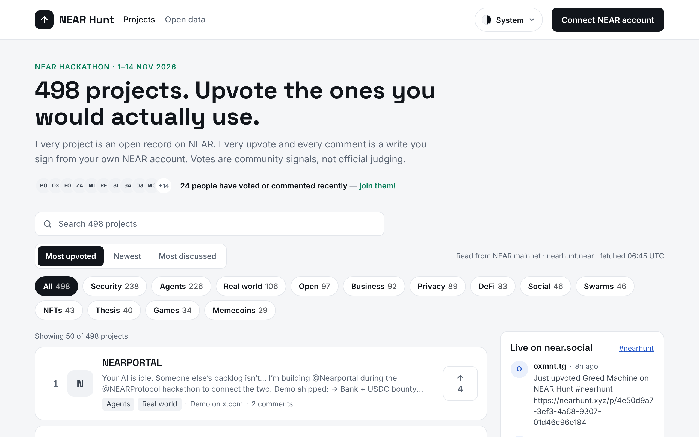
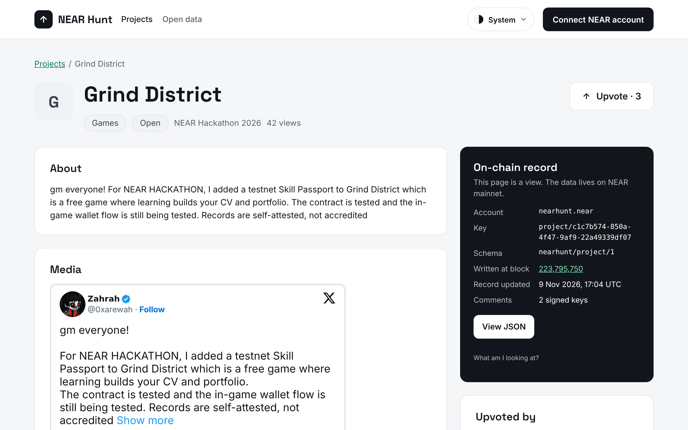

# NEAR Hunt

**Every NEAR Hackathon project in one place, where anyone with a NEAR account can upvote and
comment, and where the whole record lives on NEAR instead of in our database.**

Live at **https://nearhunt.xyz** · Built for the [NEAR Hackathon](https://nearhackathon.com)
(1–14 Nov 2026), Open Innovation track

[](https://github.com/satojandro/near-hunt/actions/workflows/ci.yml)

[](https://nearhunt.xyz)

## The problem

Almost five hundred teams submitted to this hackathon. Their work sits in one long list on the
hackathon site: a name, a track, and a link that is usually a post on X. You cannot search it by what a
project does, you cannot see which ones other people rate, and you cannot tell a builder what you
thought. When the event ends, the list goes quiet and the projects scatter.

That is a waste. A hackathon's most valuable output is not the winners; it is several hundred
working ideas and the people behind them, and almost nobody gets to look at them properly.

## What NEAR Hunt does

NEAR Hunt takes that list and makes it something you can actually explore.

- **Browse.** Every project has a card and a page of its own: the builder's description in their
  own words, their demo video or screenshots, their repository and links. Search by name, filter
  by track, sort by most upvoted, newest or most discussed.
- **Upvote.** Connect a NEAR account and upvote what you would actually use. One account, one
  vote per project, and you can take it back.
- **Talk to the builder.** Leave a comment on any project. Builders reply. Only you can delete
  what you wrote.
- **Keep it.** Every project has an address of its own, and a record on NEAR that does not
  disappear when the hackathon ends.

Votes here are a community signal. They are not the official judging, and the site says so.

## The idea behind it: the chain is the database

Most sites like this keep your votes in their own database. They can change them, lose them, or
shut down and take them along.

NEAR Hunt has no database of its own. Each project is a small, public record on NEAR mainnet.
When you upvote, **you** sign that vote from **your** account and it is written to the chain as
yours. A comment works the same way. The website is only a window onto those records: anyone can
read them without us, build their own view of them, or check that we show them honestly.

We did this without writing a smart contract. There is nothing to deploy, nothing to audit and no
storage deposit to pay. Each record is a plain key and value written to the account
`nearhunt.near`, and a public indexer makes them readable in one web request.

[](https://nearhunt.xyz/p/c1c7b574-850a-4f47-9af9-22a49339df07)

On every project page, the dark card on the right shows exactly where that record lives on chain,
and **View JSON** shows the record itself.

## What has happened so far

Measured on 11 Nov 2026, three days after the first records went on chain. The command behind
each number is in [For reviewers](#for-reviewers-check-every-claim).

- **499 project records** are on NEAR mainnet, and 498 are listed (one spam entry is hidden).
- **473** carry the builder's own description, **452** their images or video, and **253** a
  repository link, all taken from the builder's posts on X by fixed rules, with no AI involved.
- **24 people** have upvoted from their own accounts, with **43 upvotes** standing, and
  **6 people** have written **10 comments**.
- The conversations are real. On [Grind District](https://nearhunt.xyz/p/c1c7b574-850a-4f47-9af9-22a49339df07),
  a visitor wrote that the game and its learning section felt like two different apps. The builder
  replied the next day, agreed, and said what they were changing. That exchange is two signed rows
  on NEAR, and it is exactly what the hackathon's own list has no room for.

## Built for agents as well as people

More and more discovery is done by AI agents, so NEAR Hunt gives them a front door of their own
instead of making them scrape the page.

There is a free, read-only API with no key, and a guide written for agents at
[`/SKILL.md`](https://nearhunt.xyz/SKILL.md). You can tell an agent *"read NEAR Hunt's skill and
shortlist ten projects worth investigating"* and it has everything it needs. We tried it: an agent
given only the site's address produced a reasoned shortlist across the tracks, and its feedback
improved the guide. The run is kept word for word in
[`docs/agent-tests/`](docs/agent-tests/2026-11-08-nh-63-claude-shortlist.md).

Agents can read everything. They cannot vote or comment: those need a person's signature.

## Try it in two minutes

| Do | See |
|---|---|
| Open https://nearhunt.xyz | The most upvoted projects first, with search and track filters |
| Click a track, e.g. **DeFi**, or type in the search box | The list narrows, and the address bar carries the filter so you can share it |
| Click a project name | Its page: description, media, links, who upvoted, the discussion, and the **On-chain record** card |
| Click **View JSON** on that card | The raw record, as read from NEAR mainnet |
| Click **Connect NEAR account**, pick a wallet, then click an upvote arrow | The count goes up by one and your account appears under **Upvoted by**. Needs a mainnet NEAR account |
| Write a comment while connected | It appears in the discussion, signed by you |
| Open https://nearhunt.xyz/open-data | The dataset, the API endpoints and a sample record |

## How it works

| Piece | How it is done |
|---|---|
| Project records | Plain key-value rows written to `nearhunt.near` on NEAR mainnet, one per project, in an open format called `nearhunt/project/1` ([`schema/`](schema/)) |
| Upvotes | A `vote/{project}` row written by the voter. The voter is whoever signed the row, so one account is one vote |
| Comments | A `comment/{project}/{time}` row written by the commenter. Only its author can change or delete it |
| Reading | The public FastData indexer at `kv.main.fastnear.com`. No custom indexer |
| Smart contract | None, on purpose |
| Website and API | Next.js on Vercel. It caches what it reads for up to a minute and is never the source of truth |
| Moderation | We cannot delete anyone's vote or comment, and we never remove a project from the chain. Spam is hidden from the site through a public list in this repository |

The research behind these choices, including what we got wrong at first, is in
[`docs/research/`](docs/research/2026-11-08-platform-findings.md).

## Honest limits

- **One vote per account is not proof of one person.** NEAR accounts are free to create. Every
  voter is listed by account on the project page, so anyone can judge the votes for themselves.
- **The directory can trail the hackathon's list.** New submissions are written to mainnet in
  batches, and a person approves each batch. On 11 Nov, 16 submissions were waiting.
- **One record fails our own schema check.** A builder submitted an `http://` demo link where the
  format asks for `https://`. Fixing it is a mainnet write that waits for approval.
- **Wallet coverage is not fully checked.** People have voted and commented through the live site,
  but the wallet-by-wallet pass in the
  [signing checklist](docs/runbooks/day3-signing-checklist.md) is not finished.
- **View counts are approximate.** They are capped per listing but keep no visitor identity, so
  they are a rough interest signal and are labelled that way.

## What comes next

- **Open submission.** Let anyone with a NEAR account add a project, not only hackathon entrants,
  so NEAR Hunt outlives this event.
- **Claim your project.** Let a builder confirm that a listing is theirs.
- **An open format others can use.** Offer `nearhunt/project/1` as a shared way to describe a
  project on NEAR, so other apps can read and write the same records.
- **Fund this project.** A link from a project page to its funding campaign on
  [Baby Shark](#related-project--baby-shark).

The plan and its ticket list are in [`docs/PLAN.md`](docs/PLAN.md).

## How it was built (AI disclosure)

Most of the code, tests and documentation in this repository was written by AI coding agents,
directed and reviewed by the project owner:

- **Claude Code** (Anthropic) wrote most of the application, libraries and tests. Its commits
  carry a `Co-Authored-By: Claude` trailer: `git log --grep "Co-Authored-By: Claude" --oneline`.
- **Hermes**, the owner's agent on the operator machine, merges branches, deploys, and runs the
  importer. Its work is committed under the owner's git identity.

The owner sets the scope ([`docs/PLAN.md`](docs/PLAN.md)), takes the product decisions recorded
there, and approves every mainnet write before it is signed. The rules the agents work under are
in [`AGENTS.md`](AGENTS.md): no mainnet transaction without a human approving the exact diff, and
no claim in the docs without the command that reproduces it.

Two things are deliberately **not** AI:

- Project descriptions, links and media are copied from the builder's own X post by fixed rules
  ([`lib/enrichment.mjs`](lib/enrichment.mjs)). No model writes or rewrites project content.
- Nothing is scored or ranked by AI. Order comes from upvotes, comments and block height.

The work was done between 8 and 14 Nov 2026, inside the hackathon window (`git log --reverse`).
Dependencies are listed in [`package.json`](package.json); the main ones are Next.js, React,
`near-api-js` and NEAR Connect.

## Related project — Baby Shark

NEAR Hunt and **Baby Shark** are separate repositories, products and hackathon submissions,
each independently useful and functional.

- **NEAR Hunt** owns discovery, project metadata, community voting and discussion.
- **Baby Shark** owns funding campaigns, escrow, milestones and disbursement authorization.

NEAR Hunt never custodies funds and never adjudicates milestones. A Baby Shark campaign may
later reference a NEAR Hunt project ID and be surfaced as a clearly-labelled *Fund This
Project* link that opens the campaign page — no shared backend required.

## For reviewers: check every claim

Nothing above needs to be taken on trust. Each number has a command.

| Claim | Number (11 Nov 2026) | Reproduce |
|---|---|---|
| Project records on mainnet, written by `nearhunt.near` | 499 | `npm run validate:schema` |
| Projects listed on the site (one is on the [hide list](data/hidden-projects.json)) | 498 | `curl -s "https://nearhunt.xyz/api/projects?limit=1"` → `meta.total` |
| Records with a description / media / a repository | 473 / 452 / 253 | count the fields in `readProjects()` from [`lib/kv.mjs`](lib/kv.mjs) |
| Upvotes standing, and the accounts behind them | 43 from 24 accounts (55 `vote/` rows; 12 are votes taken back) | the `vote/` call below; a `null` value is a vote taken back |
| Comments standing, and their authors | 10 from 6 accounts (12 `comment/` rows; 2 deleted) | the same call with `comment/` |
| Submissions waiting to be imported | 16 | `node scripts/import.mjs` (a dry run; it signs nothing) |
| Records failing the schema | 1 of 499 (`project/1ca01819-…`, an `http://` demo link) | `npm run validate:schema` |
| Unit tests | 329 pass | `npm test` |

These numbers move: the hackathon is still open and people are still voting.

### Through the API (no key, no wallet)

```bash
# Top projects by upvotes. See: {"items":[...],"next_cursor":...,"meta":{"total":498,...}}
curl -s "https://nearhunt.xyz/api/projects?sort=votes&limit=3"

# One project. See: its nearhunt/project/1 record plus block_height, votes and url
curl -s "https://nearhunt.xyz/api/projects/4b1d7196-ba55-494a-8ccb-3daf0087744e"

# Who upvoted a project. See: a list of account ids with the block of each vote
curl -s "https://nearhunt.xyz/api/projects/c1c7b574-850a-4f47-9af9-22a49339df07/votes"

# The guide an agent reads first. See: markdown describing every endpoint
curl -s "https://nearhunt.xyz/SKILL.md"
```

`sort` is `newest` (default), `votes`, `comments` or `name`; `limit` is 1–100. The full contract
is in [`public/SKILL.md`](public/SKILL.md) and [`docs/api-contract-day4.md`](docs/api-contract-day4.md).

### Straight from the chain (no NEAR Hunt server involved)

```bash
# One project record. See: {"entries":[{"predecessor_id":"nearhunt.near","key":"project/4b1d…","value":{…}}]}
curl -s "https://kv.main.fastnear.com/v0/latest/nearhunt.near/nearhunt.near/project/4b1d7196-ba55-494a-8ccb-3daf0087744e"

# Every vote row, from every voter. See: entries whose predecessor_id is the voter
curl -s -X POST "https://kv.main.fastnear.com/v0/latest/nearhunt.near" \
  -H 'content-type: application/json' -d '{"key_prefix":"vote/","limit":200}'
```

Change `vote/` to `comment/` for comments. More in [`schema/README.md`](schema/README.md).

### Run it locally

Needs Node 20.9 or newer and network access. The app reads mainnet; it needs no keys and no
environment variables.

```bash
npm install
npm run dev               # open http://localhost:3000 and see the same directory as the live site
npm test                  # see: pass 329, fail 0
npm run typecheck         # see: no errors
npm run build             # see: the route table, ending with /wallet-manifest.json
npm run validate:schema   # see: every live record checked against the schema (1 invalid today)
node scripts/import.mjs   # see: a dry-run diff of the hackathon list against the chain; it signs nothing
```

Writing to mainnet (`node scripts/import.mjs --execute --yes`) needs a key for `nearhunt.near` and
the owner's approval of the dry-run diff: see [`AGENTS.md`](AGENTS.md) and
[`docs/runbooks/keys.md`](docs/runbooks/keys.md). View counts and analytics are optional and off
unless the variables in [`.env.example`](.env.example) are set.

### Repository layout

<details>
<summary>Where everything is</summary>

```
AGENTS.md                    rules for AI agents (mainnet writes need a human)
.github/workflows/ci.yml     typecheck, unit tests and build on every push to main and every PR
docs/
  PLAN.md                    roadmap and ticketed backlog to 14 Nov
  PRD.md                     product requirements (v0.2)
  api-contract-day4.md       the public read API: envelope, routes, as-built choices
  agent-tests/               NH-63 runs: an agent given only the URL, output verbatim
  mockups/                   every page and flow, as images, HTML and source
  proposals/                 the near.social project/ proposal (after the hackathon)
  runbooks/keys.md           function-call keys for the importer
  runbooks/new-submissions.md  new projects → enriched records: the repeatable cycle
  phase-0-spike.md           the storage spike: what was executed and what it proved
  research/                  verified platform findings, with evidence
schema/
  nearhunt-project-1.schema.json   the canonical project record, JSON Schema 2020-12
  README.md                        how to read records from chain, and the rules
types/
  nearhunt.ts                TypeScript mirrors of the record and the KV envelope
app/                         Next.js 16 app router: directory (/) and project page (/p/[id])
  robots.txt, sitemap.ts      where crawlers may go, and every listed page (NH-116)
  api/projects/              read-only JSON API (NH-60): list, one, /votes, /discussion
  open-data/                 the open data page (NH-62): dataset card, endpoints, sample record
  components/                cards, search, sort and track controls, sidebar
public/SKILL.md              the agent guide served at /SKILL.md (NH-61)
lib/
  kv.mjs                     reads from the KV API, scoped to the writer; exact timestamps
  projects.ts                cached server read used by both pages
  listing.mjs                drops tombstones and malformed rows, adds chain provenance
  directory.mjs              search, track filter, sort and URL state
  api.mjs                    the read API's pure logic: params, cursors, sort, pagination, bodies
  votes.mjs                  vote rows: one active vote per writer, tallies, voters
  comments.mjs               comment rows: keys, validation, threading, hide list, write/confirm
  comments.ts                cached server reads for the discussion page and counts
  discussion.mjs             near.social post builders (NH-40 promotion), validated
  project-view.mjs           project-page helpers: safe links, record rows, metadata
  social.mjs                 the #nearhunt sidebar feed, validated and reduced to plain text
  import-plan.mjs            diff of feed vs chain: what the importer would write
  enrichment.mjs             builder's X post → description, repository, links, media (no AI)
  media.mjs                  images/video posters from the X post, validated for the Media card
  link-probe.mjs             visit a link once: verdict, HTTP status, title, og:image
  link-label.mjs             what a link is (demo, website, video, …) and why
  duplicates.mjs             submissions sharing a repo, X post or demo (flags only)
scripts/
  import.mjs                 hackathon feed → on-chain project records (dry run by default)
  capture-threads.mjs        the builder's own replies under a submitted post (read-only)
  enrich.mjs                 enrichment proposal, link checks, duplicate flags (read-only)
  feed-watch.mjs / .sh       scheduled check: one line when the feed has new projects
  validate-schema.mjs        every live record against the schema, plus key/id invariants
  render-mockups.mjs         regenerates docs/mockups images and pages
test/                        unit tests (npm test)
data/
  submissions-snapshot.json  the source feed as read on 2026-11-08, for provenance
```

</details>

## License

MIT — see [LICENSE](LICENSE).
