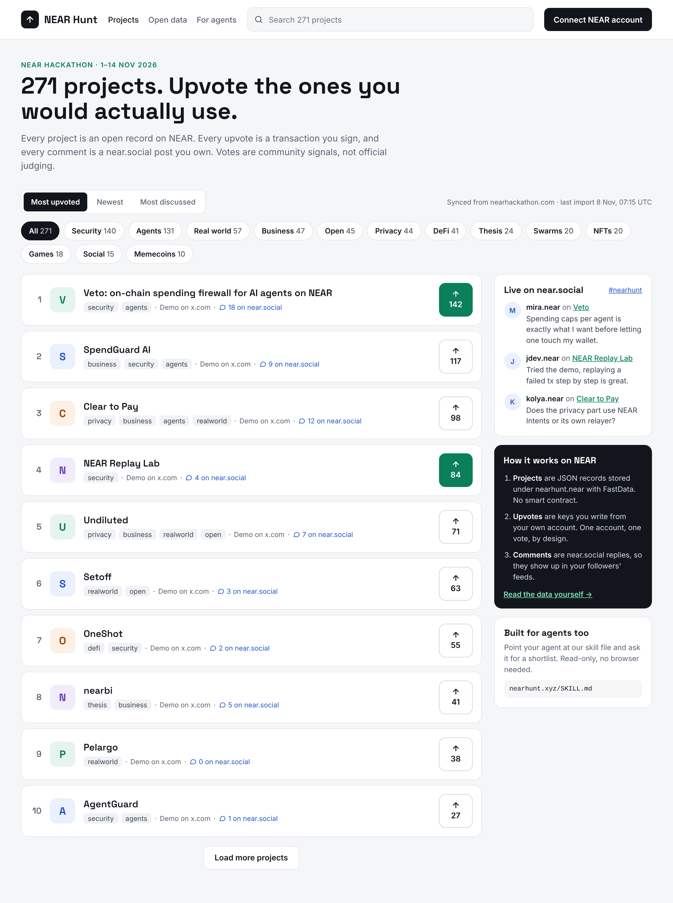
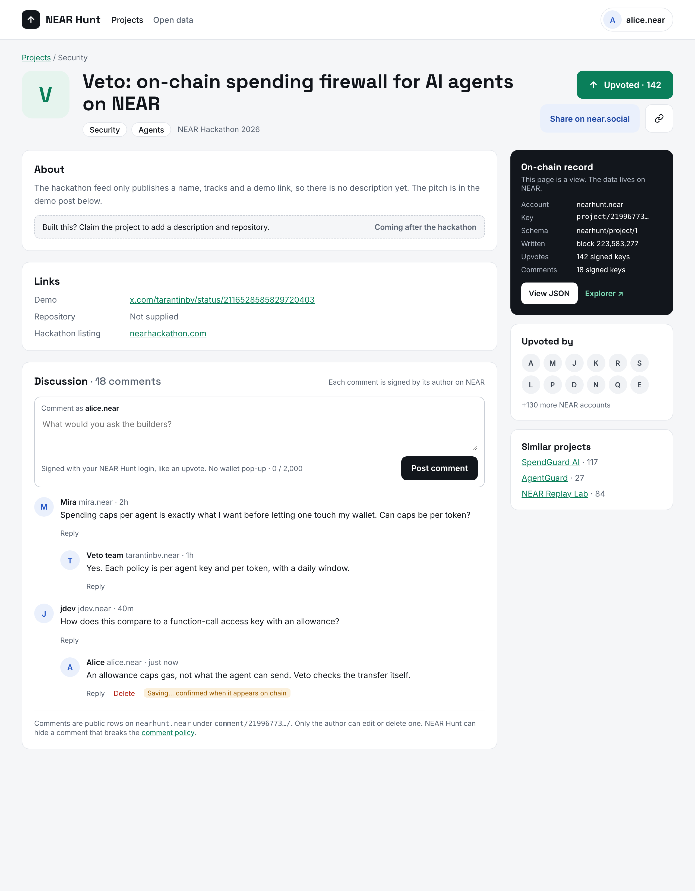
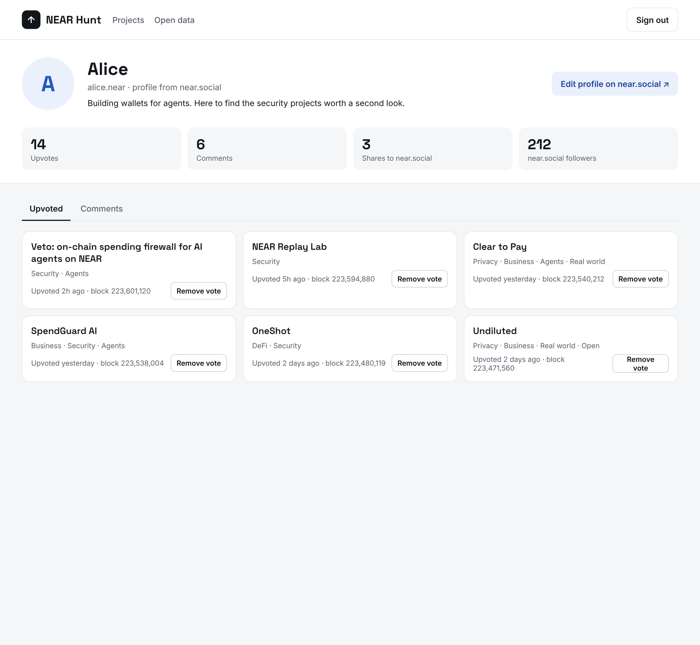
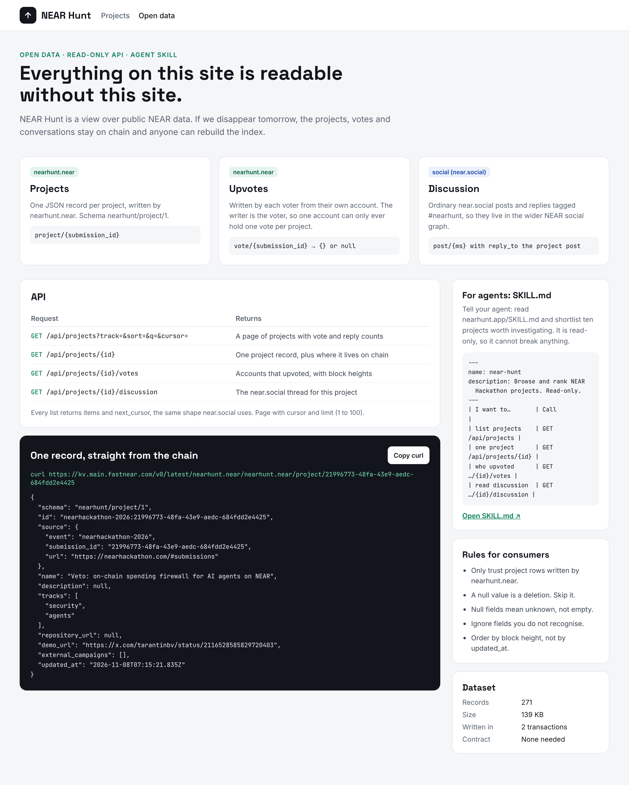
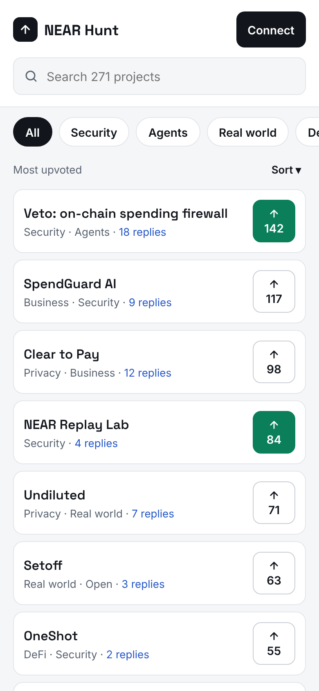
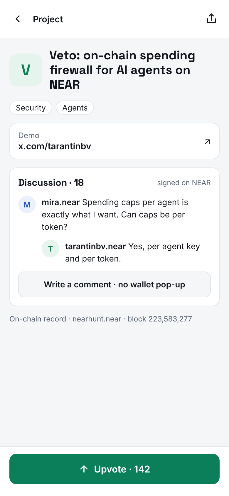
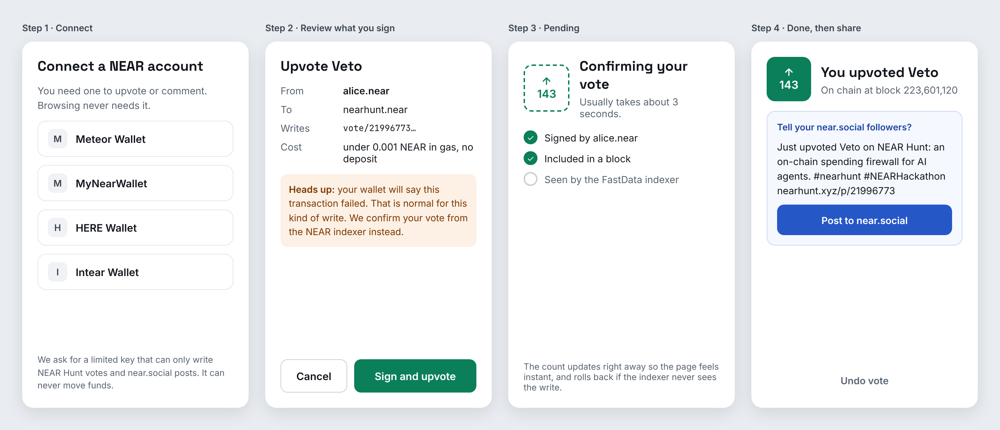
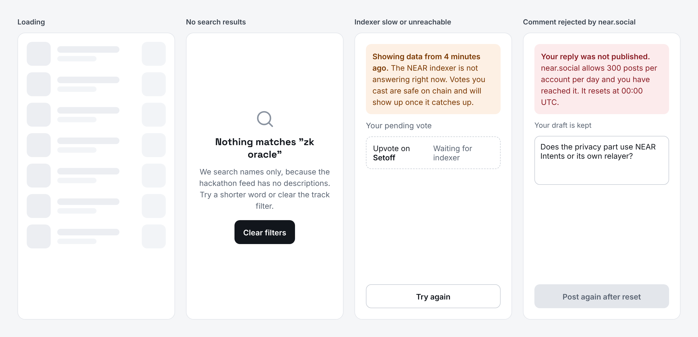
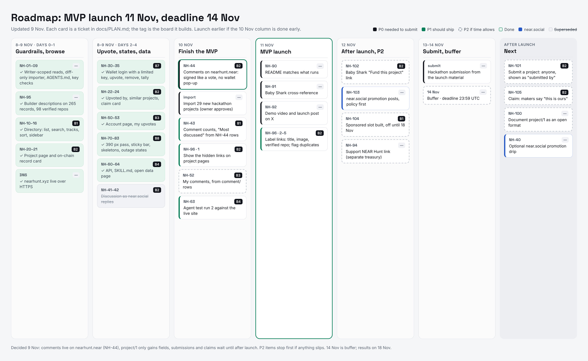

# NEAR Hunt mockups

Static mockups of every page and flow in the hackathon MVP, made on 2026-11-08. Each board
is mapped to tickets in [`../PLAN.md`](../PLAN.md).

Project names, tracks, demo links and track counts are real: they come from the 271 on-chain
records. Vote counts, reply counts, accounts and comments are sample data.

| Folder | What's in it |
|---|---|
| `png/` | Screenshots at 2× scale (shown below) |
| `html/` | Standalone pages. Open them in a browser; the links between pages work |
| `src/` | Editable board sources (`.dc.html`) and the canvas layout (`canvas.json`) |

To regenerate `png/` and `html/` after editing `src/`:

```bash
npm run render:mockups
```

No npm dependency is added for this. The script drives whichever Chrome, Chromium or Edge is
already installed over the DevTools protocol, so `npm ci` stays small and a clean clone can
regenerate the boards. Any Chromium 112+ works, including a `npx playwright install chromium`
build; set `CHROME_PATH` to the binary if it is not in a standard location. Without a browser
the script stops with an install hint instead of a stack trace.

Re-rendering in a different browser build changes the PNGs only at the antialiasing level —
the generated `html/` is identical either way.

---

## Desktop

### 1 · Directory (home)
Tickets NH-10 to NH-16, plus NH-33 and NH-43.



### 2 · Project page
Tickets NH-20 to NH-24 and NH-44 (comments on `nearhunt.near`, redrawn 9 Nov; they replaced the near.social replies of NH-41/42).



### 3 · Account page
Tickets NH-50 to NH-53.



### 4 · Open data and agents
Tickets NH-60 to NH-64.



## Mobile

### 5 · Directory and 6 · Project page
Tickets NH-70 and NH-71.

<p>
  
  
</p>

## Flows and states

### 7 · Connect and upvote
Tickets NH-30 to NH-35.



### 8 · Empty, loading and error states
Tickets NH-80 to NH-83.



## 9 · Roadmap and backlog


