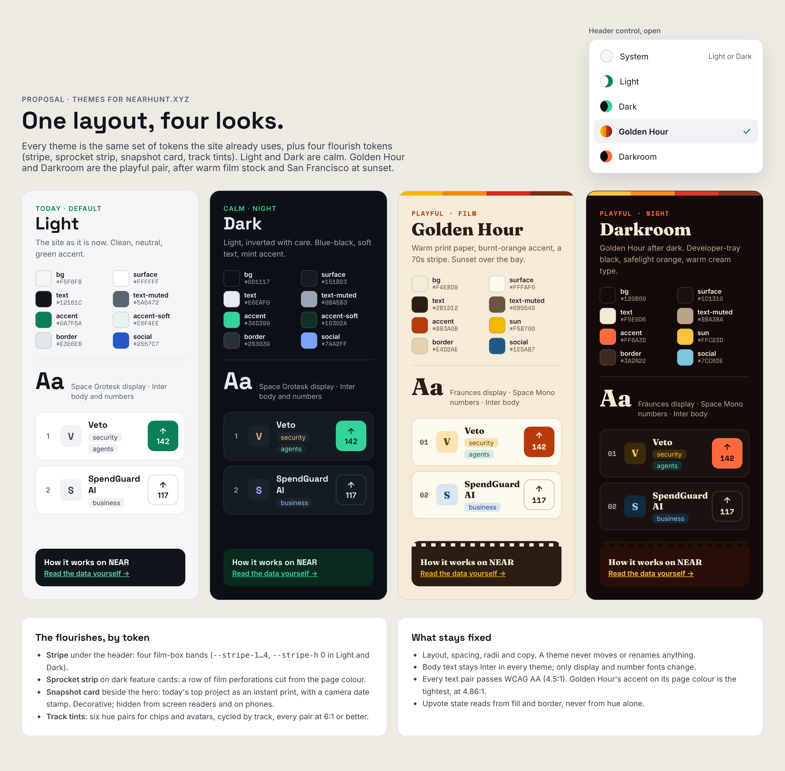
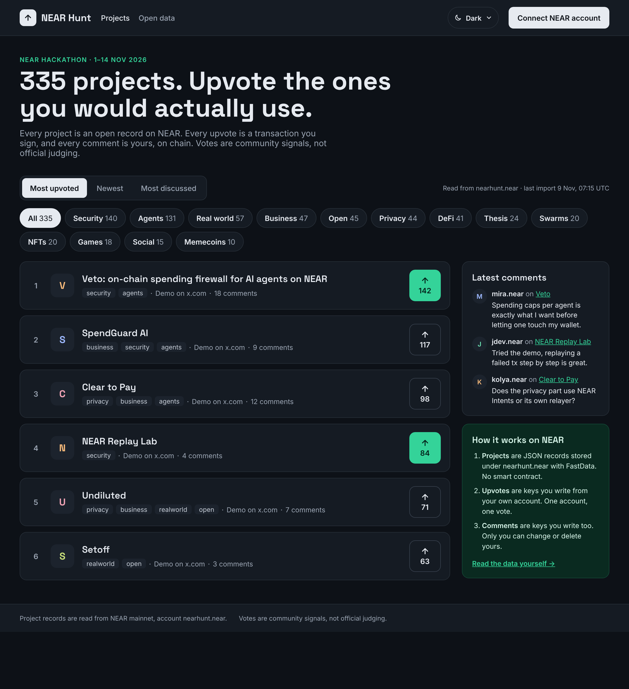
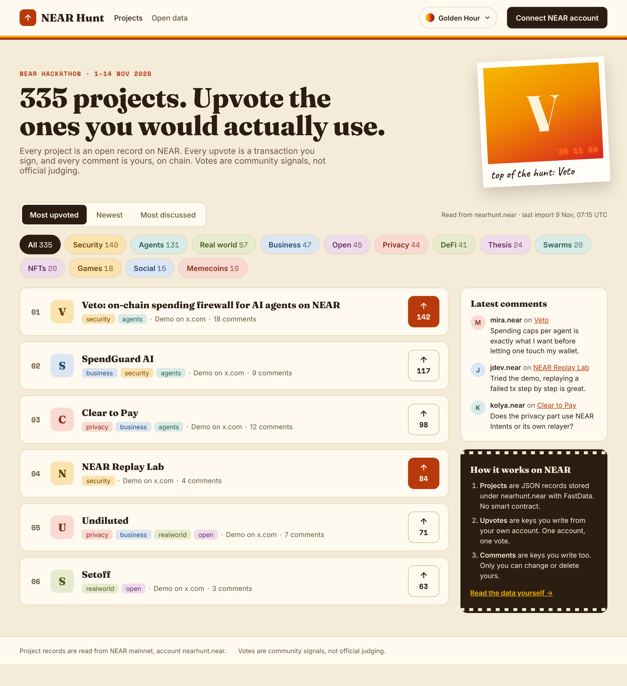
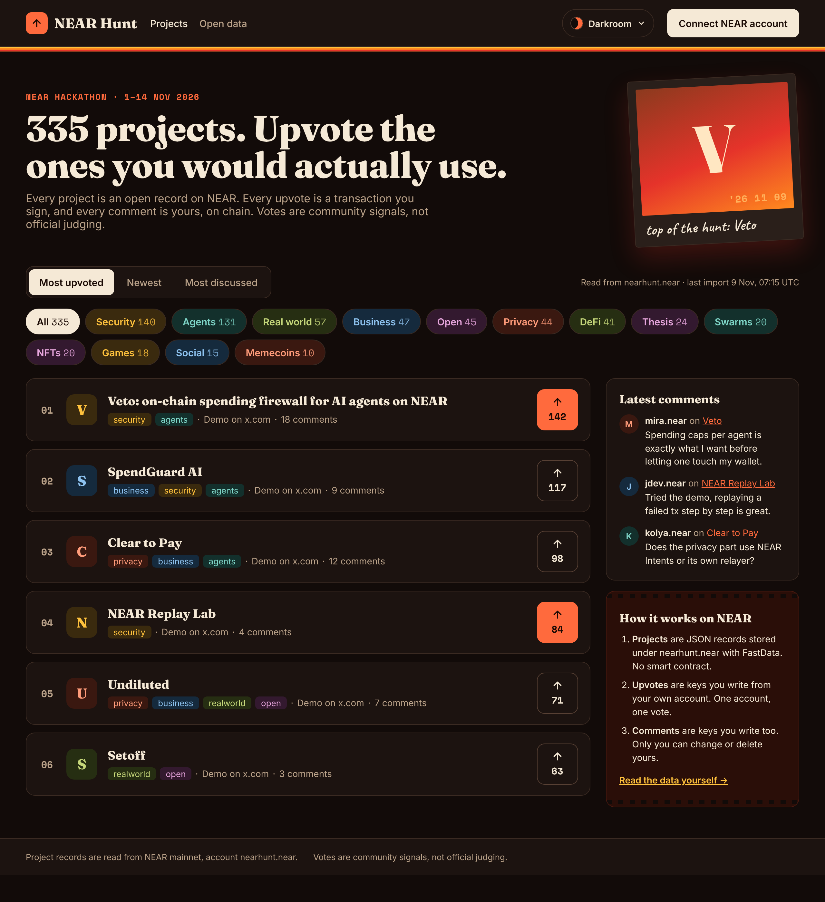

# NEAR Hunt themes: mockups and build spec

Proposal, 9 Nov 2026. This folder holds mockups only. Nothing in `app/` changes until the owner adds
the ticket below to [`../../PLAN.md`](../../PLAN.md) (AGENTS.md §5).

There are four themes and one layout. **Light** is today's site, unchanged. **Dark** is its calm
twin. **Golden Hour** and **Darkroom** are the playful pair, inspired by warm retro film stock and
San Francisco at golden hour (the NEARCON 2026 mood). They use no NEAR, NEARCON or film-brand
logos, names or artwork, only colour, type and a few decorative shapes.

| Folder | What's in it |
|---|---|
| `png/` | Screenshots at 2× |
| `html/` | Standalone pages |
| `src/` | Board sources (`.dc.html`) and `canvas.json` |
| `contrast.mjs` | WCAG check of every text pair below |

Re-render after editing `src/` (as root, Chromium also needs `--no-sandbox`; see the note in
[`../README.md`](../README.md)):

```bash
node scripts/render-mockups.mjs docs/mockups/themes/src docs/mockups/themes
```

## Boards

### T0 · Theme lineup and tokens


### T1 · Dark


### T2 · Golden Hour


### T3 · Darkroom


Project names and tracks come from real records. Vote counts, comment counts, accounts and track
counts are sample data, as on the other boards.

## How to build it

### 1. Tokens, not per-component colours

`app/globals.css` already defines `--bg`, `--surface`, `--text` and the rest on `:root`. A theme is
the same variables redefined under `html[data-theme="…"]`:

```css
:root, html[data-theme="light"] { /* today's values, unchanged */ }
html[data-theme="dark"]        { --bg: #0D1117; … }
html[data-theme="golden-hour"] { --bg: #F4EBD9; … }
html[data-theme="darkroom"]    { --bg: #120B09; … }
```

Today `app/` has about 85 hard-coded hex colours in 11 files (count:
`grep -rEc "#[0-9A-Fa-f]{3,8}\b" app --include=*.css --include=*.tsx | grep -v ":0"`), for example
`.connect-btn { color: #fff }`, the account pill and the `ProjectAvatar.tsx` tints. Each one becomes a
token, or the themes look broken. Do that sweep first, as its own commit, with no visual change in
Light.

### 2. Token values

New tokens are in **bold**. Light keeps today's values; the new tokens are defined for it too so
every theme sets the same set.

| Token | Light | Dark | Golden Hour | Darkroom |
|---|---|---|---|---|
| `--bg` | `#F5F6F8` | `#0D1117` | `#F4EBD9` | `#120B09` |
| `--surface` | `#FFFFFF` | `#151B23` | `#FFFAF0` | `#1C1310` |
| `--surface-muted` | `#F0F2F5` | `#1C232D` | `#F1E4C9` | `#261A15` |
| `--border` | `#E3E6EB` | `#283039` | `#E4D2AE` | `#3A2A22` |
| `--border-strong` | `#C9CED6` | `#3A4350` | `#C8AF82` | `#574034` |
| `--text` | `#12161C` | `#E6EAF0` | `#2B1D12` | `#F5E9D6` |
| `--text-muted` | `#5A6472` | `#9BA5B3` | `#6B5540` | `#BBA38A` |
| `--text-chip` | `#3B4450` | `#C5CCD6` | `#4A3727` | `#E0CDB4` |
| `--accent` | `#0A7F5A` | `#34D399` | `#B83A0B` | `#FF6A3D` |
| `--accent-hover` | `#075E43` | `#6EE7B7` | `#8F2C06` | `#FF8C66` |
| `--accent-soft` | `#E6F4EE` | `#10302A` | `#FDE3CF` | `#3B1A0F` |
| **`--on-accent`** (text on an accent fill, e.g. a voted button) | `#FFFFFF` | `#04221A` | `#FFF8EC` | `#1A0A04` |
| `--social` | `#2557C7` | `#7AA2FF` | `#1E5A87` | `#7CC6DE` |
| **`--btn-bg` / `--btn-text`** (Connect, selected sort tab, "All" chip) | `#12161C` / `#FFFFFF` | `#E6EAF0` / `#0D1117` | `#2B1D12` / `#FFF8EC` | `#F5E9D6` / `#1A0A04` |
| **`--feature-bg` / `--feature-text` / `--feature-link`** ("How it works" card) | `#12161C` / `#FFFFFF` / `#5FD3A6` | `#0A2A20` / `#D7F5E9` / `#34D399` | `#2B1D12` / `#F7EBD3` / `#F5B700` | `#2A0E08` / `#F5E9D6` / `#FFC23D` |
| **`--font-display`** | Space Grotesk | Space Grotesk | Fraunces 800 | Fraunces 800 |
| **`--font-num`** (ranks, vote counts, track counts, eyebrow) | Inter | Inter | Space Mono 700 | Space Mono 700 |

Body text stays Inter in every theme. Fraunces, Space Mono and Caveat (the snapshot caption only)
come from `next/font/google`. Load them only when a playful theme is active, or accept the extra
weight. Either is fine; say which in the PR.

### 3. Flourish tokens (playful themes only)

| Token | Light / Dark | Golden Hour | Darkroom | Where |
|---|---|---|---|---|
| `--stripe-h` | `0` | `8px` | `8px` | Four-band stripe under the site header |
| `--stripe-1…4` | — | `#F5B700 #F08A00 #D7261E #7A2E12` | `#FFC23D #FF8A1F #E5332A #8C3A1E` | Its colours, top to bottom |
| `--sprocket-h` | `0` | `14px` | `14px` | Film perforations top and bottom of the feature card: `repeating-linear-gradient(90deg, var(--bg) 0 8px, transparent 8px 18px)`, 6px tall |
| `--snapshot-display` | `none` | `flex` | `flex` | Instant-print card beside the hero: the #1 project's initial, a `'YY MM DD` date stamp in Space Mono with an orange glow, and a Caveat caption. Tilted −3°, `aria-hidden`, hidden below 900px |
| `--tint-1…6-bg` / `-fg` | Light: all `#F0F2F5` / `#3B4450`; Dark: bg `#1C232D`, fg in the table in `contrast.mjs` | see `contrast.mjs` | see `contrast.mjs` | Track chips and project avatars. Track → tint: security 1, agents 2, privacy 3, business 4, realworld 5, open 6, defi 5, thesis 6, swarms 2, nfts 6, games 1, social 4, memecoins 3 |

Golden Hour and Darkroom show ranks as `01`, `02` (zero-padded, `--font-num`); Light and Dark keep `1`, `2`.

### 4. The theme picker

- A header button showing the current theme ("Golden Hour ▾"), `aria-haspopup="menu"`, at least
  44px tall. Its menu (board T0, top right) has **System**, Light, Dark, Golden Hour and Darkroom as
  `menuitemradio`, with the current one checked.
- **System** is the default: Light or Dark from `prefers-color-scheme`. The two playful themes are
  only ever picked by hand.
- Store the choice in `localStorage` (`nh-theme`) in a `try`/`catch`. It is a per-visitor preference,
  never written on chain and never sent to analytics.
- Set `data-theme` before first paint with a small inline script in `<head>` in `app/layout.tsx`, so
  a dark visitor never sees a white flash. Put `suppressHydrationWarning` on `<html>`.
- Set `<meta name="theme-color">` to the theme's `--surface`.
- On phones the header nav is hidden (NH-106), so the picker must stay visible there, or move into
  the footer nav.

### 5. Acceptance

- Light is pixel-identical to today after the token sweep (compare screenshots before and after).
- Every page (directory, `/p/{id}`, `/u/{id}`, `/open-data`, `/comment-policy`, the states and the
  wallet pop-over) is checked in all four themes, on desktop and at 390px.
- `node docs/mockups/themes/contrast.mjs` exits 0. Today it prints:

  ```
  light        12 pairs, lowest 4.63:1 (accent (links) on bg)
  dark         18 pairs, lowest 6.95:1 (text-muted on surface)
  golden-hour  18 pairs, lowest 4.86:1 (accent (links) on bg)
  darkroom     18 pairs, lowest 6.42:1 (accent (links) on surface)
  ```
- Voted and not-voted upvote buttons differ by fill and border, not by hue alone, in every theme.
- `npm test` and `npm run typecheck` pass. No change to anything that reads or writes NEAR.

## Proposed ticket (owner to add to PLAN.md)

| ID | Pri | Ticket |
|---|---|---|
| NH-114 | P2 | Themes: Light (today), Dark, Golden Hour and Darkroom, built from the tokens and picker in `docs/mockups/themes/README.md`. Step 1 is the token sweep with no visual change; step 2 adds the themes and the picker. Front end only: no chain reads or writes change |

P2 because it is not launch-critical. It lands after the MVP launch unless the owner says otherwise.
